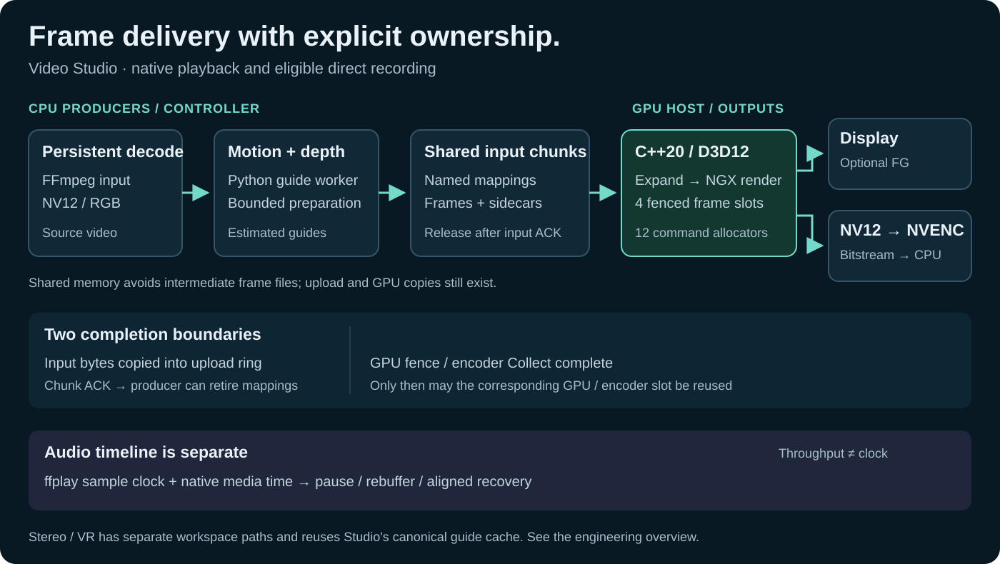

# Engineering overview

[Project front page](README.md) · [Кратко по-русски](ENGINEERING_OVERVIEW_RU.md) · [Version history](ENGINEERING_HISTORY.md)

Video Studio is an independent Windows application whose central systems problem is delivering frames across a Python producer, a native D3D12 renderer, a hardware encoder and an interactive player. Fast inference alone does not solve resource lifetime, backpressure, presentation timing or a clean shutdown.

This overview describes the already-public implementation at [`b2ddf8b`](https://github.com/Absamad-dew/dlss5-video-studio/tree/b2ddf8ba3ac6d25f9b23545f8c9aa00ef6dd43a5). Measurements below are retained historical observations from the [V22 validation note](OPTIMIZATION_V22_RU.md), not new benchmarks performed for this document.

## From a video file to useful outputs

| User workflow | Output | Execution distinction |
|---|---|---|
| Realtime playback | Presented video with audio; optional Streamline/Reflex frame generation | Source-speed presentation with a prepared-frame buffer; no recording encoder runs in the realtime profile |
| Recording | H.264/H.265 MP4; audio muxed into the completed video | Eligible continuous recording keeps NV12 on the GPU through NVENC; the controller handles the final audio/video mux |
| Stereo / VR | Full/Half SBS and OU layouts; native Studio and separate pinned IW3 workspace | Studio shares a stabilized depth/motion cache across its stereo consumers; the reference workspace retains upstream IW3 processing |

The branches are configurable workflows, not a claim that every option takes the same fast path. Direct D3D12 NVENC is restricted to continuous recording without preview or intermediate chunk encoding. Advanced stereo reconstruction has its own cost and validation limits; [native VR QA](NATIVE_VR_QA_RU.md) explicitly records that the tested full 4K-eye workflow is far from realtime.

## Frame ownership and backpressure

The controller coordinates persistent decoding and guide generation. The compact DIS transport can keep ordinary 4:2:0 video in NV12 plus packed motion/depth sidecars; the native host expands these into GPU inputs. Other profiles can retain RGB transport. Named pagefile-backed mappings avoid repeatedly serializing full RGB frames through files, but this is **not** an end-to-end zero-copy pipeline: upload, conversion and GPU copies still exist.

| Resource | Owner / lifetime boundary | Why the boundary matters |
|---|---|---|
| Shared input chunks | Python worker retains mappings until the controller issues an ordered release | A consumer must not read a retired mapping; the controller can publish the replacement before freeing the old mapping |
| Chunk acknowledgement | Native host increments a shared monotonic counter after input bytes have entered the per-slot upload ring | The producer can replenish the queue without waiting for the entire chunk's GPU work to drain |
| Native GPU slots | Four frame slots; command allocator reuse waits on the host fence | The twelve allocators cover three submissions per frame; chunk acknowledgement does not authorize early GPU resource reuse |
| NVENC resources | A slot remains pending through encode and bitstream collection; mapped resources are then unmapped | A second submit to a pending slot is rejected instead of overwriting a frame still owned by the encoder |

The raw fallback pipe is sized in complete NV12 frames, with a 16–64 MiB bound. The direct path transports compressed bytes and uses a 4 MiB pipe. Ordinary recording bounds prepared DIS chunks in flight rather than accumulating a whole film in RAM. These are different buffers with different owners, not one global queue.

Source: [host allocator fencing](https://github.com/Absamad-dew/dlss5-video-studio/blob/b2ddf8ba3ac6d25f9b23545f8c9aa00ef6dd43a5/native/dlss5_video_host.cpp#L305), [chunk acknowledgement and drain](https://github.com/Absamad-dew/dlss5-video-studio/blob/b2ddf8ba3ac6d25f9b23545f8c9aa00ef6dd43a5/native/dlss5_video_host.cpp#L4344), [controller release order](https://github.com/Absamad-dew/dlss5-video-studio/blob/b2ddf8ba3ac6d25f9b23545f8c9aa00ef6dd43a5/app/process-video.ps1#L1816), [bounded recording production](https://github.com/Absamad-dew/dlss5-video-studio/blob/b2ddf8ba3ac6d25f9b23545f8c9aa00ef6dd43a5/app/process-video.ps1#L1744).

## Recording: keep raw output on the GPU

The host converts rendered output to NV12 on the GPU and copies the planes into the encoder's D3D12 input texture. `D3D12NvEncoder::Submit` maps registered resources, provides the input-ready fence/value, and asks NVENC to signal the output fence. `Collect` locks the compressed bitstream, writes it to the sink, unlocks and unmaps resources, and makes the slot reusable. The final drain submits EOS and collects remaining slots before closing the muxing pipe.

Only the compressed video crosses to the CPU in the normal direct path. FFmpeg receives H.264/HEVC and muxes with `-c:v copy`; the controller later adds audio. Diagnostic reference capture deliberately reintroduces raw readback and must be disabled in throughput measurements.

Two compatibility decisions are explicit in the code:

- `Auto` can fall back to FFmpeg NVENC **during initialization, before any frame/output process exists**. A mid-recording failure is reported instead of silently restarting an incomplete file.
- The fallback tags its raw input as BT.709 limited range. The V22 investigation found that missing input tags caused an unintended YUV→RGB→YUV CPU conversion in FFmpeg 9; output metadata alone did not prevent it.

Startup-only full-resolution upload buffers are released after their GPU fence, and three unused sets are not allocated. The published 183 MiB at 1440p / 411 MiB at 4K are resource-size calculations, not measured reductions in total process VRAM.

Source: [encoder submit/collect/flush](https://github.com/Absamad-dew/dlss5-video-studio/blob/b2ddf8ba3ac6d25f9b23545f8c9aa00ef6dd43a5/native/nvenc_d3d12.h#L211), [GPU NV12 conversion](https://github.com/Absamad-dew/dlss5-video-studio/blob/b2ddf8ba3ac6d25f9b23545f8c9aa00ef6dd43a5/native/dlss5_video_host.cpp#L3145), [fallback, mux and pipe sizing](https://github.com/Absamad-dew/dlss5-video-studio/blob/b2ddf8ba3ac6d25f9b23545f8c9aa00ef6dd43a5/native/dlss5_video_host.cpp#L3426), [upload release](https://github.com/Absamad-dew/dlss5-video-studio/blob/b2ddf8ba3ac6d25f9b23545f8c9aa00ef6dd43a5/native/dlss5_video_host.cpp#L3981), [final audio mux](https://github.com/Absamad-dew/dlss5-video-studio/blob/b2ddf8ba3ac6d25f9b23545f8c9aa00ef6dd43a5/app/process-video.ps1#L1975).

## Realtime: throughput is not the playback clock

Guide generation and rendering can run ahead of presentation. The player therefore treats `real_fps` as throughput telemetry, not an instruction to change audio tempo. It observes ffplay's audio sample-clock telemetry and native media timestamps, preserves one normal-speed audio endpoint through ordinary pause/rebuffer transitions, and freezes/resumes that endpoint rather than reopening it on every state event.

If recovery requires reopening the audio device, alignment accounts for elapsed transition time and measured startup latency. Duplicate resume events leave a healthy endpoint alone. Explicit state transitions drive alignment; a noisy instantaneous FPS sample does not.

Lifetime is also part of playback correctness: Streamline owns asynchronous presentation work. The public shutdown fix suspends frame generation, fences the relevant queues and calls `slShutdown` while tagged textures and DXGI/D3D12 objects still exist. The [reproduced post-playback crash and fix](REALTIME_DEPTH_FIX_V22_0_1_RU.md) are retained rather than treating the last displayed frame as successful process completion.

Source: [sample-clock observation](https://github.com/Absamad-dew/dlss5-video-studio/blob/b2ddf8ba3ac6d25f9b23545f8c9aa00ef6dd43a5/app/realtime-player.ps1#L286), [pause/resume and restart alignment](https://github.com/Absamad-dew/dlss5-video-studio/blob/b2ddf8ba3ac6d25f9b23545f8c9aa00ef6dd43a5/app/realtime-player.ps1#L474), [throughput versus media time](https://github.com/Absamad-dew/dlss5-video-studio/blob/b2ddf8ba3ac6d25f9b23545f8c9aa00ef6dd43a5/app/realtime-player.ps1#L544), [ordered Streamline shutdown](https://github.com/Absamad-dew/dlss5-video-studio/blob/b2ddf8ba3ac6d25f9b23545f8c9aa00ef6dd43a5/native/dlss5_video_host.cpp#L1348).

## What the measurements establish

The [retained September 4 V22 comparison](OPTIMIZATION_V22_RU.md) used RTX 4060 Laptop, 120 real 2560×1440 frames at 25 FPS, H.265 P1/LL, QP 18, neutral motion/depth, one warmup and three repetitions per path. Source decoding and guide generation were excluded.

| Boundary | Correctly tagged FFmpeg NVENC | D3D12 NVENC | Interpretation |
|---|---:|---:|---|
| Native-stage median throughput | 24.393 FPS | 29.981 FPS | +22.9% within the measured stage |
| Native benchmark process median, including launch | 7.745 s | 6.963 s | Same isolated workload, with startup included; not the whole application |
| Full recording, separate 240-frame run | — | 22.86 s / 10.50 FPS | Includes guides, model loading and audio; 13.76 FPS guide generation was the reported limiting stage |

The same note retains the individual repetitions, p95/CV, a later compressed-pipe tuning result and short realtime output checks. There is no basis for transferring the +22.9% stage gain to every complete workflow.

Correctness was checked against **the exact GPU frames captured in one run**, re-encoded using matched FFmpeg settings. The retained tests found exact decoded pixel/timestamp parity for the documented H.265 1440p/4K and H.264 1080p cases. Separate full NGX runs had small differences after frame 58 in one comparison; these are not represented as encoder equality or a general visual-quality improvement. The old constant-color transport fixture is explicitly synthetic.

Reviewable QA entry points: [same-frame encoder comparison](tests/test-direct-nvenc.ps1), [pixels/PTS/DTS/color checks](tests/compare-video-frames.ps1), [audio pause/resume](tests/test-audio-pause-resume.ps1), [long audio sync probe](tests/test-audio-long-sync.ps1), [model preflight](tests/test-depth-preflight.ps1), [native VR QA](NATIVE_VR_QA_RU.md). Their presence is not a claim that all were rerun for this documentation update.

## Build, packaging and scope

Use [the front-page build steps](README.md#build-and-run) and the unchanged [full prerequisites](ENGINEERING_HISTORY.md#build-prerequisites). This source tree is not a new prebuilt 22.3 application; existing release model packs supplement prepared portable folders. Original project code is [MIT licensed](LICENSE); NVIDIA SDKs/runtimes, ReShade, models and other components retain their [own terms](THIRD_PARTY_NOTICES.md).

Ordinary video does not provide authoritative game-engine geometry, camera matrices or motion vectors. Guides are estimated, behavior depends on content/profile, and the application is an independent project rather than an official NVIDIA product. No deployment scale, commercial adoption or generalized image-quality gain is claimed.
