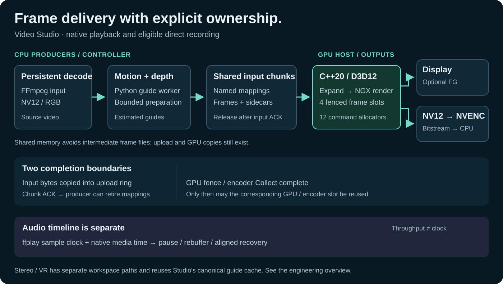

# Инженерный обзор

[README](README.md) · [Подробный обзор с кодовыми ориентирами](ENGINEERING_OVERVIEW.md) · [Полная история разработки](ENGINEERING_HISTORY.md)

Video Studio — самостоятельное Windows-приложение на C++20/D3D12, Python и WPF/PowerShell. Главная инженерная задача — провести кадр через декодирование, генерацию guides, GPU-обработку, аппаратный encoder и пользовательское воспроизведение, сохранив порядок, ограниченную память и корректное завершение.

## Что получает пользователь

- Realtime: видео со звуком и подготовленным буфером; опциональная NVIDIA Frame Generation через Streamline/Reflex. Этот профиль не запускает encoder записи.
- Recording: H.264/H.265 MP4 с финальным добавлением аудио. Обычная непрерывная запись без preview может использовать прямой D3D12→NVENC путь.
- Stereo/VR: Full/Half SBS и OU, основной Studio-путь и отдельное pinned IW3 reference workspace. Общий стабилизированный depth/motion cache используется потребителями Studio; цена восстановления и пределы описаны в [VR QA](NATIVE_VR_QA_RU.md).

## Решения, которые видны в публичном коде

| Задача | Решение и проверяемая граница |
|---|---|
| Не накапливать фильм в RAM | Ограниченные очереди чанков, named shared memory и четыре GPU-слота |
| Не освобождать вход раньше времени | Host подтверждает чанк после копирования входа в upload-ring; controller публикует замену и упорядоченно освобождает старые mappings |
| Не перезаписать ресурс GPU/encoder | Fence защищает повторное использование allocator; NVENC запрещает submit в pending-слот, Collect завершает lock/unlock/unmap |
| Убрать raw readback из обычной записи | GPU-конверсия в NV12 → D3D12 NVENC → сжатый поток на CPU → FFmpeg mux без перекодирования видео |
| Не маскировать повреждённую запись | Auto-fallback разрешён при инициализации, до первого кадра; ошибка в середине не вызывает скрытый повторный запуск |
| Сохранить звук при паузе/rebuffer | Измеряемый sample clock ffplay и native media timestamps; throughput FPS не используется как скорость аудио |
| Корректно завершить Frame Generation | Отключение FG, ожидание очередей и slShutdown до освобождения tagged textures |

Shared-memory transport не означает zero-copy всей цепочки: upload и GPU-копии остаются. Размеры raw fallback pipe и compressed pipe различаются; прямой NVENC не применяется ко всем комбинациям настроек. [Подробная карта владельцев и ссылки на строки кода](ENGINEERING_OVERVIEW.md#frame-ownership-and-backpressure) показывают эти границы.

## Измеренный эффект, без смешения стадий

Сохранённый [V22 A/B](OPTIMIZATION_V22_RU.md): RTX 4060 Laptop, 120 настоящих кадров 2560×1440, 25 FPS, H.265 P1/LL, QP 18, нейтральные guides, один прогрев и три повтора. Декодирование исходника и генерация guides исключены.

| Граница измерения | Было: FFmpeg NVENC с корректными input tags | Стало: D3D12 NVENC |
|---|---:|---:|
| Медиана native-stage FPS | 24,393 | 29,981 (+22,9%) |
| Медиана native benchmark-процесса со стартом | 7,745 с | 6,963 с |

Полная запись — отдельное измерение: 240 кадров, 22,86 с / 10,50 FPS с guides, загрузкой моделей и аудио. Guides дали 13,76 FPS и ограничивали этот фрагмент. Ускорение native-стадии нельзя переносить на всё приложение. Это исторические данные из публичной заметки, новых GPU-прогонов для обзора не было.

Encoder parity проверяется на одних и тех же захваченных GPU-кадрах: декодированные пиксели, PTS/DTS, длительность и цветовая разметка. В отдельных полных NGX-прогонах сохраняются небольшие различия; они не объявлены ни потерей encoder, ни доказательством улучшения картинки. Синтетический одноцветный fixture не служит оценкой качества реального видео.

## Сборка и границы

Инструкции [сборки](README.md#build-and-run), [SDK и зависимостей](ENGINEERING_HISTORY.md#build-prerequisites), [история версий](ENGINEERING_HISTORY.md), [MIT](LICENSE) и [лицензии сторонних компонентов](THIRD_PARTY_NOTICES.md) сохранены. Source 22.3 и старые portable model packs — разные поставки; репозиторий не содержит новый готовый 22.3 binary bundle.

Motion/depth оцениваются из обычного видео, поэтому не равны данным игрового движка. Проект независим от NVIDIA; документ не заявляет production adoption или универсальный выигрыш качества. Исходные пользовательские видео, изображения и локальные QA-артефакты здесь не публикуются.
