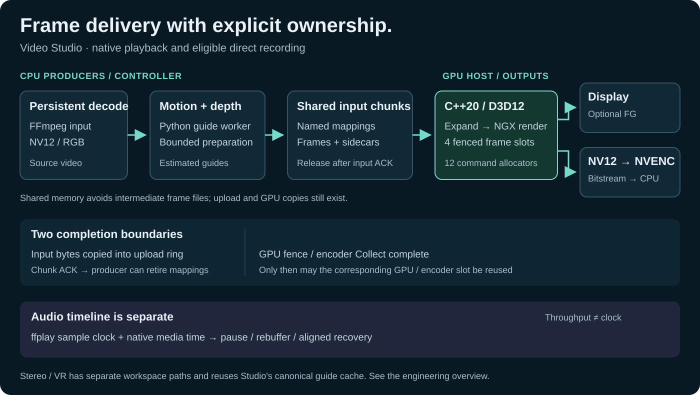

# DLSS5 Video Studio

**C++20 / D3D12 / NVENC · Python workers · WPF/PowerShell desktop application**

An independent Windows video-processing system for realtime playback, recording and stereo/VR. Its core engineering work is moving frames between persistent producers, shared memory, GPU queues, hardware encoding and an interactive player—with explicit ownership, bounded buffering and a separate audio timeline.

[Engineering overview](ENGINEERING_OVERVIEW.md) · [Обзор на русском](ENGINEERING_OVERVIEW_RU.md) · [Full Russian documentation](PROJECT_DOCUMENTATION_RU.md) · [Interface guide](INTERFACE_RU.md) · [Engineering history](ENGINEERING_HISTORY.md)



## Three user workflows

| Workflow | What it produces | Implementation to inspect |
|---|---|---|
| **Realtime** | Presented video and audio; optional NVIDIA Frame Generation through Streamline/Reflex | Prepared-frame buffering, source-speed presentation, sample-clock audio pause/recovery, ordered GPU shutdown |
| **Recording** | H.264/H.265 MP4 with audio | GPU NV12 → D3D12 NVENC for eligible continuous recording; compressed output to FFmpeg muxing |
| **Stereo / VR** | Full/Half SBS and OU; native Studio and separate pinned IW3 workspace | Shared stabilized motion/depth cache, native rendering and explicit reference/experimental paths |

Direct NVENC applies to continuous recording without preview or intermediate chunk encoding. Realtime does not encode a recording, and advanced stereo reconstruction has a separate performance envelope. [Architecture and ownership](ENGINEERING_OVERVIEW.md) explain these boundaries.

## Measured optimization: 24.393 → 29.981 FPS

The retained V22 A/B comparison improved **native-stage median throughput by 22.9%** on RTX 4060 Laptop. It used 120 real 1440p frames, one warmup and three repetitions per path, matched H.265 P1/LL and QP 18, and neutral guides to isolate delivery/encoding.

| Measurement boundary | FFmpeg NVENC, corrected input color tags | Direct D3D12 NVENC |
|---|---:|---:|
| Native-stage median | 24.393 FPS | **29.981 FPS** |
| Native benchmark process, including launch | 7.745 s | **6.963 s** |

Both rows exclude source decoding and guide generation. A **separate complete recording** of 240 frames took 22.86 s / 10.50 FPS with guides, model loading and audio; guides were the reported limiting stage. The stage gain is not an application-wide speedup claim. [Settings, repetitions, later tuning and limitations](OPTIMIZATION_V22_RU.md) remain available.

Correctness is checked by encoding **the exact GPU frames captured in the same run** through both backends, then comparing decoded pixels, PTS/DTS, duration and color metadata. Separate complete NGX runs can differ; the repository retains that evidence and labels synthetic transport fixtures. This is encoder parity evidence, not a general image-quality score.

## Systems decisions visible in the code

| Decision | Why it matters | Public implementation |
|---|---|---|
| Separate input acknowledgement from GPU completion | Replenish the producer queue without freeing or overwriting in-flight GPU resources | [Four-slot ring, allocator fences and chunk lifetime](ENGINEERING_OVERVIEW.md#frame-ownership-and-backpressure) |
| Keep raw recording frames on the GPU through NVENC | Remove normal raw-output readback; retain an explicit diagnostic capture path | [Mapped resources, input/output fences, EOS drain and safe fallback](ENGINEERING_OVERVIEW.md#recording-keep-raw-output-on-the-gpu) |
| Treat throughput, media time and device startup as different clocks | Avoid audio tempo/restart loops during slow chunks, pause and rebuffering | [Audio sample-clock handling and Streamline shutdown](ENGINEERING_OVERVIEW.md#realtime-throughput-is-not-the-playback-clock) |

The [engineering overview](ENGINEERING_OVERVIEW.md) links directly to stable source lines. [Version-by-version history](ENGINEERING_HISTORY.md) preserves the earlier design work; [V22 validation](OPTIMIZATION_V22_RU.md), [startup/shutdown fix](REALTIME_DEPTH_FIX_V22_0_1_RU.md), [native VR architecture](NATIVE_VR_RU.md), [VR QA](NATIVE_VR_QA_RU.md) and [IW3 integration](IW3_VR_V22_1_RU.md) retain the detailed evidence.

## Build and run

[Clean-checkout build guide](BUILDING.md) covers CPU checks, the independently buildable launcher, native SDK preflight, external SDK paths and allowlisted source/developer packaging. Build scripts fail early on missing dependencies and perform no implicit downloads. Source packages and compiled developer builds are distinct from a complete GPU runtime.

The [CPU geometry preflight](scripts/demo-preflight.py) exercises the production settings and stereo-dimension checks without GPU inference. [Instructions](DEMO_GUIDE.md#public-walkthrough-three-minutes) · [Existing tests](tests/test_iw3_worker.py) · [Implementation decisions](docs/DECISION_TIMELINE.md).

This is a source project, not a one-command portable distribution. Prepare **Windows 10/11 x64**, Visual Studio 2022 Build Tools, the required NGX/Streamline SDKs and the dependencies for your chosen guide engine. Build with:

```bat
build_native.bat
build_ui.bat
```

[Complete build prerequisites and model-pack instructions](ENGINEERING_HISTORY.md#build-prerequisites) explain the required folder layout. Optional installers are explicit; heavyweight checkpoints are not silently downloaded as part of a test.

## Current source / packaged releases

The source documents version 22.3. Existing [release model packs](https://github.com/Absamad-dew/dlss5-video-studio/releases) supplement prepared portable folders and do not constitute a new prebuilt 22.3 application. Proprietary NVIDIA/ReShade payloads, large model weights, user video and local diagnostics are excluded.

This is an independent project, not an official NVIDIA product. Input video does not contain authoritative engine motion or geometry; estimated guides have content-dependent limitations. Original source is [MIT licensed](LICENSE); SDKs, add-ons and models retain [their own terms](THIRD_PARTY_NOTICES.md). [Detailed limitations and licensing](ENGINEERING_HISTORY.md#important-limitations).
